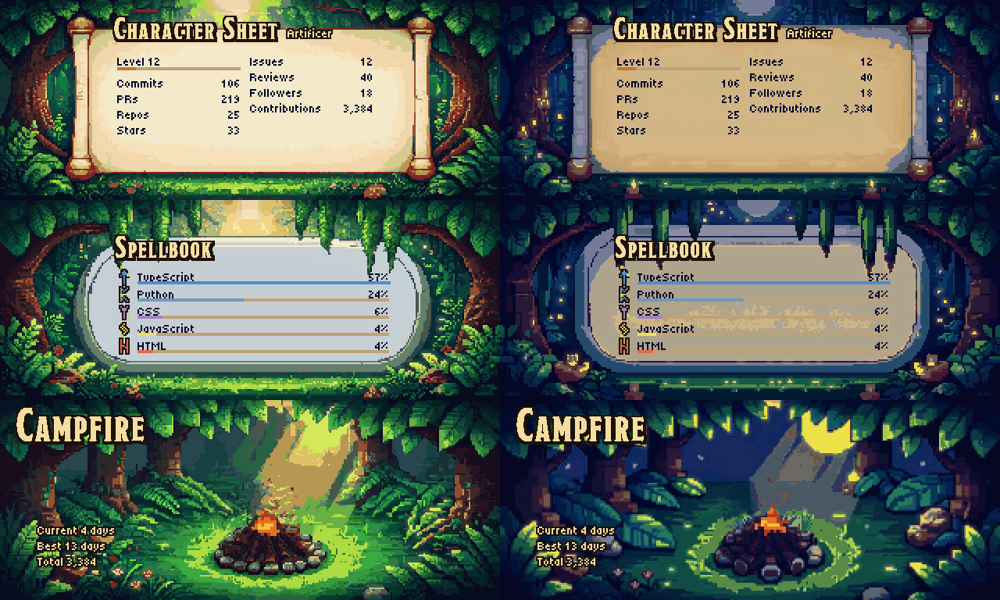
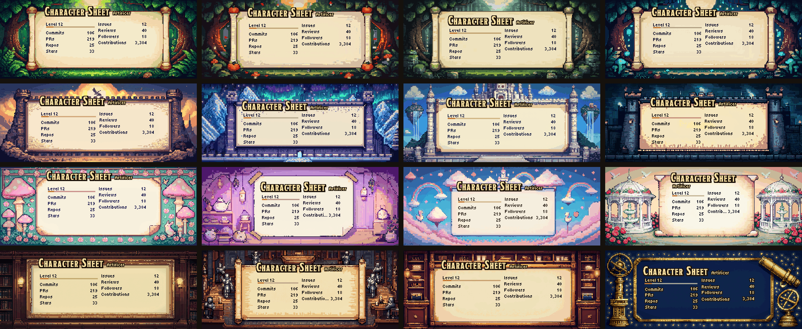

# questlog-github-stats

Pixel-art GitHub profile cards with a medieval feel: a character sheet, a spellbook of your languages and a campfire for your streak. Paste one line into your profile README: no token, no workflow, no setup.



| Card | Shows |
|---|---|
| `/stats` | level (from lifetime contributions), commits, PRs, repos, stars, issues, reviews, followers, contributions |
| `/languages` | your top five languages, each with its own rune |
| `/streak` | current and best streak, total contributions; the fire grows with your streak |

## Use it

Open https://questlog.cevdetbaran.com, type your login, pick a scene and copy the snippet. Or write it yourself:

```html
<picture>
  <source media="(prefers-color-scheme: dark)" srcset="https://questlog.cevdetbaran.com/stats?user=octocat&scene=forest&time=night">
  
</picture>
```

With `<picture>`, readers in dark mode get the night version of the scene automatically.

The first time a card is requested you'll see a "the scribe is inking your sheet" card for a few seconds while your stats are fetched. Refresh and it's there. Cards update every 12 hours. If GitHub's hourly limit is ever reached, the card says how many minutes the wait is.

## Scenes

Sixteen scenes in four themes. Every scene has all three cards, by day and by night, painted to match each other, so a profile that uses one scene throughout looks like one place.



| Theme | `scene=` |
|---|---|
| Forest | `forest` (default), `forest-autumn`, `forest-misty`, `forest-moonlit` |
| Castle | `castle`, `castle-aurora`, `castle-sky`, `castle-storm` |
| Cozy | `fairy-garden`, `witch-cottage`, `cloud-kingdom`, `rose-garden` |
| Scholarly | `royal-library`, `war-room`, `guild-hall`, `observatory` |

The gallery shows each scene's Character Sheet in the order of the table.

## Options

| Parameter | Values | Default |
|---|---|---|
| `user` | your GitHub login | required |
| `scene` | any scene above | `forest` |
| `time` | `day`, `night` | `day` |
| `title` | any text | the scene's title |
| `subtitle` | any text | `/stats`: a class from your top language |
| `labels` | `key:Text,key:Text`, e.g. `commits:Deeds` | the scene's labels |
| `hide` | comma list, e.g. `prs,stars` or `html,css` on `/languages` | none |
| `animate` | `true`, `false` | `true` |

Only public data is shown. Private contributions count if you've enabled "Include private contributions" in your GitHub profile settings.

## Run your own

```bash
docker build -t questlog .
docker run -d -p 8080:8080 --env-file .env -v questlog-data:/data questlog
```

`.env` holds `GITHUB_TOKEN=` with a fine-grained token that can read public repositories (see `.env.example`). The server listens on `PORT` (8080) and keeps its cache in `DATA_DIR` (`/data`). With your own token, your own instance can count your private contributions too.

## Development

The pages at `/` and `/wiki` come from `site/`, a Next.js static export that the binary embeds. Build it before `cargo build`: `cd site && npm ci && npm run build` (it writes `static/`).

## License

Code: MIT (see `LICENSE`). Art: © Cevdet Baran Oral, CC BY-NC 4.0 (see `ART-LICENSE.md`): free for non-commercial use with credit; commercial use, including a commercial self-hosted instance, needs written permission (contact@cevdetbaran.com). Fonts: see `fonts/README.md`.
