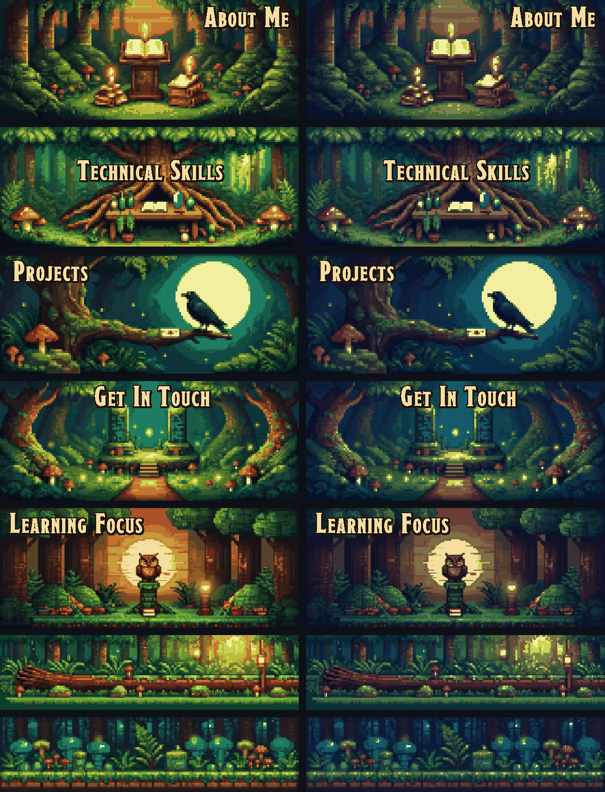

# questlog-github-stats

[](https://github.com/BaranDev/questlog-github-stats/actions/workflows/ci.yml) [](LICENSE) [](ART-LICENSE.md)

Pixel art GitHub profile cards with a medieval feel: a character sheet, a spellbook of your languages and a campfire for your streak. Paste one line into your profile README: no token, no workflow, no setup.

**[Website](https://questlog.cc)** · **[Profile builder](https://questlog.cc/builder)** · **[Wiki](https://questlog.cc/wiki)** · **[Status](https://questlog.cc/status)**


| Card | Shows |
|---|---|
| `/stats` | level (from lifetime contributions), commits, PRs, repos, stars, issues, reviews, followers, contributions |
| `/languages` | your top five languages, each with its own rune |
| `/streak` | current and best streak, total contributions; the fire grows with your streak |

## Use it

Open the [profile builder](https://questlog.cc/builder), type your login, add cards and copy your README; a short tour shows you around the first time. Or write it yourself, one line per card:

```md

```

The address reads `/<login>/<card>/<scene>/<time>`, and the last two are optional: `https://questlog.cc/octocat/streak/forest-misty/night`. Every other option goes after a `?`, e.g. `https://questlog.cc/octocat/languages/castle?langs=3`. The longer form `https://questlog.cc/stats?user=octocat&scene=castle` works too.

To switch to the night painting for readers in dark mode, use GitHub's `<picture>` tag instead:

```html
<picture>
  <source media="(prefers-color-scheme: dark)" srcset="https://questlog.cc/octocat/stats/forest/night">
  
</picture>
```

The first time a card is requested you'll see a "the scribe is inking your sheet" card for a few seconds while your stats are fetched. Refresh and it's there. Cards update every 12 hours. If GitHub's hourly limit is ever reached, the card says how many minutes the wait is. [questlog.cc/status](https://questlog.cc/status) shows whether the service is up and letting new users in.

## Scenes

Sixteen scenes in four themes. Every scene has all three cards, by day and by night, painted to match each other, so a profile that uses one scene throughout looks like one place.


| Theme | `scene=` |
|---|---|
| Forest | `forest` (default), `forest-autumn`, `forest-misty`, `forest-moonlit` |
| Castle | `castle`, `castle-aurora`, `castle-sky`, `castle-storm` |
| Cozy | `fairy-garden`, `witch-cottage`, `cloud-kingdom`, `rose-garden` |
| Scholarly | `royal-library`, `war-room`, `guild-hall`, `observatory` |

The gallery shows each scene's Character Sheet in the order of the table.

## Decorations

Painted banners to head a section of your README or divide two, with an optional title in the card title style. They show no stats, so they need no login. Like the cards, each one is painted by day and by night.



```md

```

To switch to the night painting for readers in dark mode, add `time=night` to the dark source:

```html
<picture>
  <source media="(prefers-color-scheme: dark)" srcset="https://questlog.cc/decorations/reading-nook?title=About%20Me&time=night">
  
</picture>
```

| Decoration | Painting |
|---|---|
| `reading-nook` | a candlelit lectern in the forest; title on the right |
| `workbench` | a table under a great tree's roots; title in the middle |
| `raven-moon` | a raven before the moon; title on the left |
| `enchanted-clearing` | a glowing gate between old trees; title at the top |
| `crystal-owl` | an owl on a mossy pillar at sunset, by a flickering lantern; title on the left |
| `forest-divider` | a mossy log, lower than the others; no title unless you give one |
| `forest-footer` | glowing mushrooms and ferns, as low as the divider; for the end of a README |

Decorations take only `title`, `title_color`, `outline_color`, `truncate`, `animate`, `scale`, `time` (`time=night` for the night painting) and `pixels`; any other option draws an error card.

## Options

| Parameter | Values | Default |
|---|---|---|
| `user` | your GitHub login | required |
| `scene` | any scene above | `forest` |
| `time` | `day`, `night` | `day` |
| `pixels` | `fine`, `chunky`: `chunky` draws the painting in pixels twice as big; text, bars and fire stay sharp | `fine` |
| `title` | any text, up to 60 characters | the scene's title |
| `subtitle` | any text, up to 60 characters | `/stats`: a class from your top language; none on the others |
| `labels` | `key:Text,key:Text`, e.g. `commits:Deeds`; keys below | the scene's labels |
| `values` | `key:Text,key:Text`, e.g. `level:Archmage`; keys below. Replaces the drawn value; bars, notches and the fire still follow your real numbers | your numbers |
| `note` | up to 2 lines split by `\|`, e.g. `Open to work\|DMs open` | none |
| `title_color` | hex `RRGGBB` or `RGB`, `#` optional (write it as `%23`), e.g. `FFD700` | the scene's ink |
| `text_color` | hex, as above; colors every other text | the scene's ink |
| `outline_color` | hex, as above; the dark edge around outlined text | the scene's ink |
| `fire` | `classic`, `themed`: on `/streak`, `themed` draws the scene's own fire colors | `classic` |
| `langs` | `3`, `5`: how many languages `/languages` lists | `5` |
| `hide` | comma list, e.g. `prs,stars` or `html,css` on `/languages` | none |
| `truncate` | `true`, `false`: `false` draws a long `subtitle` whole instead of trimming it with "..." (it may then run past the page) | `true` |
| `animate` | `true`, `false` | `true` |
| `scale` | `1` to `5`, the output size (320×128 times this) | `5` |

Keys are case-insensitive. At most 20 pairs in `labels` and in `values`, keys up to 20 characters, any text up to 60 characters; text that does not fit its place is trimmed with "...".

| Card | `labels` keys | `values` keys |
|---|---|---|
| `/stats` | `level`, `commits`, `prs`, `repos`, `stars`, `issues`, `reviews`, `followers`, `contributions` | the same |
| `/languages` | any language name, e.g. `typescript`, `c%23` (C#), `c%2B%2B` (C++), `jupyter notebook`; `percent` (the `%` after each share); `empty` (the text for an account with no languages) | any language name; replaces that row's percent |
| `/streak` | `current`, `best`, `total`, `days` (the unit after current and best) | `current`, `best`, `total`; replaces the whole value, unit included |

A note goes where the card has room: under the rows on `/stats`, across both columns when the whole note fits there and under the right column otherwise; under the language rows on `/languages`, where each note line takes the place of the last row, and beside the fire on `/streak`. Hiding rows with `hide` makes more room. A color that is not valid hex draws an error card, like any other bad option.

Only public data is shown. Private contributions count if you've enabled "Include private contributions" in your GitHub profile settings.

## Run your own

```bash
docker build -t questlog .
docker run -d -p 8080:8080 --env-file .env -v questlog-data:/data questlog
```

A self-hosted instance must credit the paintings as **"questlog by Cevdet Baran Oral"**, linked to https://questlog.cc, on the pages that show the cards and in its README (see `ART-LICENSE.md`); it can run under its own address.

`.env` holds `GITHUB_TOKEN=` with a fine-grained token that can read public repositories (see `.env.example`). `NEW_LOGINS_PER_HOUR` (600 by default) caps how many logins are fetched for the first time each hour; raise it for a busy day, GitHub's own limit still pauses fetching when it runs low. The server listens on `PORT` (8080) and keeps its cache in `DATA_DIR` (`/data`). With your own token, your own instance can count your private contributions too.

**Watching it.** The server writes one plain line per request and per background event to stderr (`docker logs questlog`): what was asked, whether the card came from the memory cache, the disk cache or was drawn (and how long that took), each GitHub fetch with the quota left, queue decisions, and a status line every 15 minutes. Client IPs are never written; the Cloudflare ray id links a line to Cloudflare's own logs. `/status` and `/health` show the public state (up, whether GitHub fetching runs, whether new users get in, with times in UTC). `/admin/status` and `/admin/health` show every count and capacity, the last hour's traffic and the latest log lines. Put them behind a Cloudflare Access app and set `ACCESS_TEAM_DOMAIN`, `ACCESS_AUD` and `ADMIN_EMAILS` (see `.env.example`): the server then checks the login token Access signs on every request, so the pages stay closed even if someone reaches the server another way. Without those settings they open only for a local run.

## Development

The pages at `/`, `/builder`, `/wiki`, `/status` and `/admin/status` come from `site/`, a Next.js static export that the binary embeds. Build it before `cargo build`: `cd site && npm ci && npm run build` (it writes `static/`).

The cards on those pages are not drawn live: the site ships its own WebP copies in `site/public/cards/`. After a change to the art or the drawing, build the site, run a local server of the new build, draw the copies again with `uv run site/scripts/snap_cards.py http://127.0.0.1:8080`, then build the site once more.

## Contributing

Bug reports, ideas and pull requests are welcome; [CONTRIBUTING.md](CONTRIBUTING.md) explains how to run it and test a change. Please report security problems privately, as [SECURITY.md](SECURITY.md) describes. Changes are listed in [CHANGELOG.md](CHANGELOG.md).

## License

The code and the art have different licenses.

- **Code: MIT** (see `LICENSE`). Use it, change it, self-host it.
- **Art: © Cevdet Baran Oral, CC BY-NC 4.0** (see `ART-LICENSE.md`). This covers the paintings and sprites in `art/` and `assets/`, and the cards drawn from them.
  - Free for non-commercial use with credit, such as cards on your own GitHub profile.
  - A self-hosted instance keeps the credit "questlog by Cevdet Baran Oral", linked to questlog.cc.
  - Commercial use needs written permission, and that includes a commercial self-hosted instance. Ask at contact@cevdetbaran.com.
- **Fonts:** their own licenses (see `fonts/README.md`).
